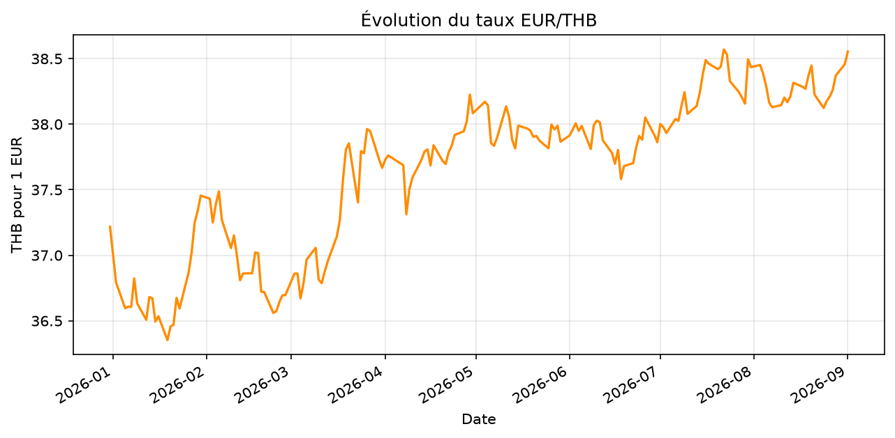
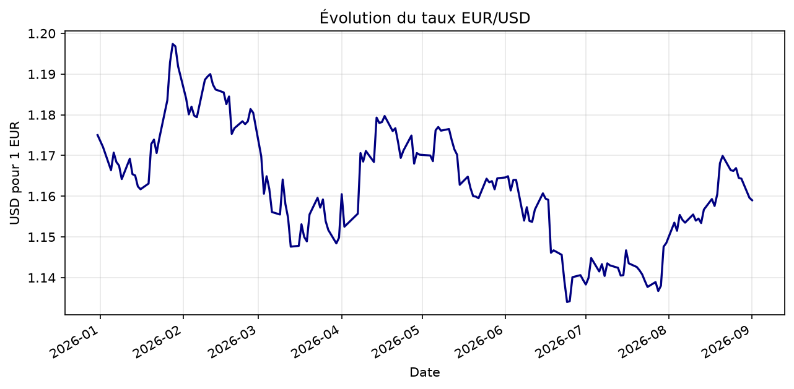
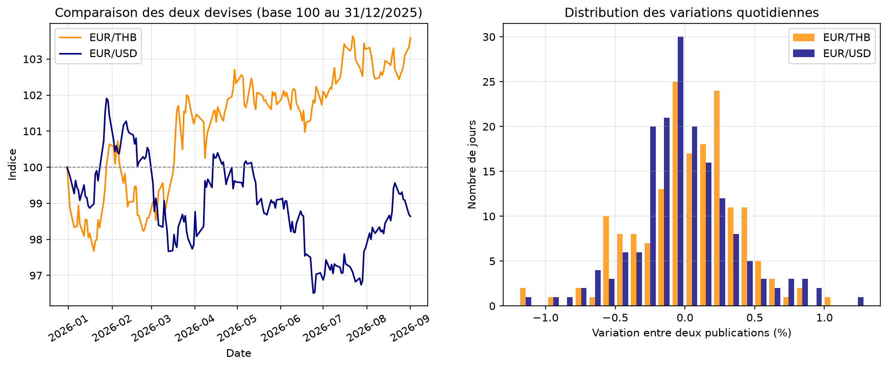

# Rapport final — Projet Python, groupe X

Luca Radu, Victor Mavre-Gigot, Théophile Le Metter, Léopold Santamaria — BFA1, 2026-2027.

## 1. Objectif

Récupérer, nettoyer, analyser et représenter les taux de change de référence de la BCE pour les deux devises du groupe, le baht thaïlandais (THB) et le dollar américain (USD), en base euro, du 1er janvier au 1er septembre 2026.

## 2. Démarche, séance par séance

**Séance 1 — Bases et premier appel API.** Prise en main de Python (types, opérations, conditions, boucles) et de Git/GitHub (dépôt, branches, commits, pull requests). Exploration d'une réponse d'API sous forme de dictionnaire (mutabilité, copie superficielle et profonde). Premier appel réel à l'API Frankfurter avec `urllib` et `json` : la réponse brute est gardée dans `cache/` et convertie en CSV dans `donnees/`.

**Séance 2 — Fonctions, erreurs, récursivité.** Le traitement est découpé en fonctions documentées (lecture du CSV, moyenne, min/max), comparées à `statistics.mean`. L'appel API est protégé par `try/except` (erreur HTTP comme le 403, absence de réseau, délai, JSON illisible) et journalisé avec `logging` dans `logs/api.log`. Les trois versions de Fibonacci (naïve, mémoïsée, itérative) sont comparées en temps et en mémoire : à n = 30, 92 ms pour la version naïve contre moins de 0,01 ms pour les deux autres.

**Séance 3 — pandas, jointures, numpy.** Les CSV sont chargés dans des DataFrame. Les 4 jours ouvrés sans publication (jours fériés) sont comblés par forward-fill. On calcule la variation, une moyenne mobile sur 5 jours et des moyennes mensuelles (`resample`). Les deux devises sont réunies par une jointure `inner` sur la date (171 lignes, aucune perte). Les calculs sont refaits en numpy (vectorisation, broadcasting) puis en polars.

**Séance 4 — Python idiomatique, classes, graphiques, finalisation.** Le code est réécrit avec des compréhensions, `enumerate`, `zip`, `sorted`, des f-strings et des `lambda`. La classe `SerieTaux` regroupe les taux d'une devise et ses méthodes (moyenne, variation, taux à une date, variations quotidiennes) ; une instance est créée par devise, et une `dataclass` résume chaque série. Les graphiques sont produits avec matplotlib, et l'ensemble est relié par un outil en ligne de commande (`main.py`, avec `argparse`) organisé autour d'un package `src/`.

## 3. Données

- EUR/THB et EUR/USD : 171 observations chacune, du 31/12/2025 au 01/09/2026, mêmes dates pour les deux séries.
- Le 31/12/2025 apparaît car le 1er janvier est férié : l'API renvoie le dernier taux publié avant la date demandée.
- Jours ouvrés sans publication : 1er janvier, 3 et 6 avril (Pâques), 1er mai 2026.

## 4. Résultats

| Série | Moyenne | Écart-type | Min | Max | Variation sur la période |
|---|---:|---:|---:|---:|---:|
| EUR/THB | 37.652 | 0.599 | 36.353 (19/01) | 38.570 (22/07) | **+3.59 %** |
| EUR/USD | 1.1624 | 0.0143 | 1.1340 (24/06) | 1.1974 (28/01) | **−1.36 %** |

**Lecture.**

- **EUR/THB** : l'euro s'est apprécié face au baht, avec une tendance haussière presque continue de mars à septembre (moyenne mensuelle de 36,76 en janvier à 38,27 en août).
- **EUR/USD** : l'euro a culminé fin janvier (1,1974), puis s'est replié jusqu'à fin juin (1,1340) avant de remonter partiellement en août.
- **Comparaison en base 100** : les deux séries évoluent en sens opposé sur la période. Le THB s'est donc affaibli face à l'USD : le taux croisé THB pour 1 USD passe d'environ 31,7 à 33,3, soit une hausse d'environ 5 %.
- **Volatilité** : les variations quotidiennes ont une dispersion très proche pour les deux paires (écart-type d'environ 0,37 % par jour). La quasi-totalité des variations reste comprise entre −1 % et +1 %.

## 5. Limites

- Ce sont des taux de **référence** publiés une fois par jour par la BCE, pas des prix de transaction.
- Le forward-fill suppose que le taux ne change pas les jours fériés ; ce n'est pas un taux réellement observé.
- La période (8 mois) est courte : les tendances observées ne permettent pas de prévoir l'évolution future.
- Les mesures de temps (Fibonacci, pandas vs polars) dépendent de la machine ; sur 171 lignes, la comparaison pandas/polars ne permet pas de conclure en général.

## 6. Sources

- API Frankfurter, taux de référence BCE : https://api.frankfurter.app — documentation : https://frankfurter.dev
- Énoncés des séances 1 à 4 (R. Gargouri). L'IA a été utilisée comme aide, comme l'autorisent les énoncés ; le groupe a relu et compris l'ensemble du code et des réponses.
